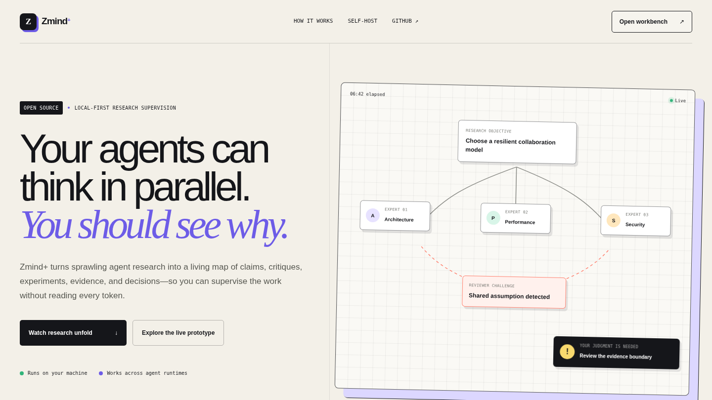

# Zmind+

**The open-source interface for supervising agent research.**

Zmind+ turns sprawling agent sessions into a live, inspectable map of questions,
hypotheses, critiques, experiments, evidence, and decisions. It is local-first,
provider-neutral, and designed for humans who need to stay in control without
reading every token.

> See every hypothesis. Challenge every conclusion.

[](docs/assets/zmind-plus-demo.mp4)

_Watch the 30-second product film: delegation, adversarial review, experiment,
evidence reversal, and human judgment._

## Why Zmind+

Trace viewers are good at showing calls, latency, and failures. Research work has
a different shape: conclusions change, reviewers challenge assumptions, evidence
conflicts, and experiments invalidate earlier wins. Zmind+ preserves that shape.

```text
question
  ├─ hypothesis A ─ critique ─ experiment ─ evidence ─ supported
  ├─ hypothesis B ─ critique ─ experiment ─ evidence ─ refuted
  └─ open question ─ delegated expert ─ waiting for evidence
```

The default view answers three questions:

1. What are the agents doing now?
2. Where is the important disagreement?
3. Where does human judgment add the most value?

## Product principles

- **Local first:** raw transcripts and artifacts stay on the user's machine.
- **Human legibility:** show research meaning, not internal IDs or raw JSON.
- **Evidence over confidence:** every conclusion can be traced to its support.
- **Reversible projections:** immutable events produce graphs, timelines, and
  documents without destroying history.
- **Provider neutral:** adapters may support any agent runtime or event source.
- **Public-safe development:** the repository contains only synthetic scenarios.

## Project status

Zmind+ now includes a runnable local workbench, immutable typed event protocol,
SQLite persistence, replayable live updates, a provider-neutral import SDK, and
an optional privacy-safe Claude Code lifecycle adapter. The included research
scenario is fully synthetic.

See [Product and architecture](docs/PRODUCT_AND_ARCHITECTURE.md) and
[Research notes](docs/RESEARCH_NOTES.md). The progressive-disclosure strategy
and scale budgets are documented in
[Graph scale plan](docs/GRAPH_SCALE_PLAN.md).

## Run the workbench

Requirements: Node.js 24 or newer.

```bash
git clone https://github.com/hrterry/zmind-plus.git
cd zmind-plus
git switch codex/foundation
npm install
npm run dev
```

Open [http://127.0.0.1:4310](http://127.0.0.1:4310). This starts both the local
runtime and the workbench. Until a run is ingested, the interface clearly stays
in Demo mode. To exercise the complete SQLite and SSE path, run this in a second
terminal:

```bash
npm run seed:demo
```

The included scenario is fully synthetic and demonstrates delegation, critique,
experimentation, evidence, conclusion reversal, and a human decision request.

For a no-terminal workflow, use **Import** in the workbench to choose a JSONL
event log. Zmind+ validates the complete file in the browser before writing
bounded batches to the loopback runtime, then opens the imported run
automatically. **Export** downloads the selected run as portable JSONL. Files up
to 25 MiB use this one-click flow; the CLI remains available for larger archives
and automation.

Import a provider-neutral event stream from JSONL (stdin is also supported):

```bash
npm run import:jsonl -- --file ./run.jsonl
```

The SDK validates the whole input before sending bounded, idempotent batches to
the local runtime. See [Adapter SDK plan](docs/ADAPTER_SDK_PLAN.md) for the event
boundary and integration contract.

All host-side clients use the public local gateway at `127.0.0.1:4310` by
default, so the same commands work in development and Docker. Override the URL
only when running the Runtime API by itself or changing the Docker host port.

### Watch Claude Code activity

Build and link the optional local hook command, then print a settings fragment:

```bash
npm run build --workspace=@zmind-plus/adapter-claude-code
npm link ./packages/adapter-claude-code
npm run claude:settings
```

Merge the generated hooks into the Claude Code settings scope you want, then
use `/hooks` in Claude Code to verify them. The adapter visualizes sessions,
subagents, tasks, tool activity, failures, and completion. It discards prompts,
responses, transcript paths, working directories, task descriptions, tool
inputs, and tool outputs before contacting the loopback runtime.

See the [adapter instructions](packages/adapter-claude-code/README.md) and
[privacy and event-mapping plan](docs/CLAUDE_CODE_ADAPTER_PLAN.md).

### Record the semantic research map

Lifecycle hooks show activity without reading content. To let Claude or another
MCP host explicitly record questions, critiques, experiments, evidence, and
decisions, connect the local MCP recorder:

```bash
npm run build --workspace=@zmind-plus/mcp-server
npm link ./packages/mcp-server
claude mcp add zmind-plus -- zmind-mcp
```

The recorder uses the official MCP TypeScript SDK v2. It exposes six focused
tools and writes only the structured content deliberately supplied to those
tools. See the [MCP recorder instructions](packages/mcp-server/README.md).

### Self-host with Docker

```bash
docker compose up --build -d
```

Open [http://127.0.0.1:4310](http://127.0.0.1:4310). The web container is the
only host-facing service; it proxies ingestion and live SSE to the private
runtime container. SQLite persists in the `zmind-data` volume. Override the host
port with `ZMIND_PORT`, or supply a comma-separated `ZMIND_UI_ORIGINS` when
placing Zmind+ behind another local origin.

Quality checks:

```bash
npm run format:check
npm run lint
npm run typecheck
npm test
npm run benchmark:graph
npm run check:public
npx playwright install chromium
npm run test:e2e
npm run build
```

The graph benchmark generates provider-neutral corpora at 1k, 5k, and 20k
nodes. Browser binaries are cached on the development machine and are never
committed to the repository.

Regenerate the public demo poster, WebM master, and MP4 product film with:

```bash
npm run capture:demo
```

The capture drives the same landing-page research scene used by visitors; there
is no separate mock video implementation.

## License

[MIT](LICENSE)
