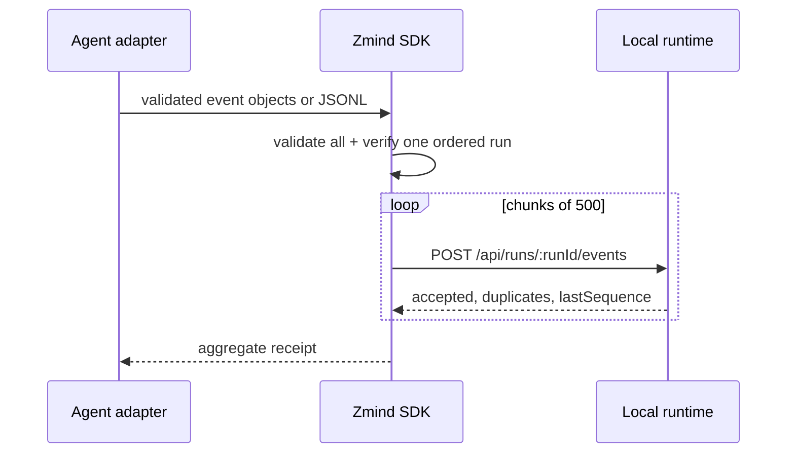

# Adapter SDK and JSONL Import Plan

## Outcome

Any agent runtime that can emit the Zmind+ event envelope should be able to send
a live run without depending on the web application or writing a custom HTTP
client.

```text
agent hook         exported JSONL         custom adapter
    │                    │                      │
    └──────────────┬─────┴──────────────────────┘
                   ▼
             @zmind-plus/sdk
        validate → order → batch (500)
                   │
                   ▼
       local runtime HTTP ingestion
                   │
             SQLite + live SSE
```

The SDK is provider-neutral. It accepts only the public event protocol and does
not parse or capture raw prompts, responses, or private transcript formats.

## Library contract

- `parseResearchJsonl(text)` validates every non-empty line and reports the
  failing line number without echoing its content.
- `ZmindClient.append(events)` validates the complete input before networking.
- A call may contain only one run and must already be sequence ordered.
- Batches are posted sequentially in groups of at most 500, matching the local
  runtime transaction boundary.
- Identical retries rely on the runtime's idempotency contract.
- Network and server errors are human-readable and never include event bodies.



## CLI contract

```bash
zmind-import --file run.jsonl --runtime http://127.0.0.1:4310
cat run.jsonl | zmind-import --runtime http://127.0.0.1:4310
```

- stdin is the default input.
- `--file -` explicitly selects stdin.
- the runtime defaults to the loopback API.
- success output contains only counts, run ID, and final sequence.
- invalid arguments or data exit non-zero with no stack trace or raw payload.

## Review gates

- More than 1,000 events produce multiple bounded requests and one aggregate
  receipt.
- Invalid JSON, schema errors, mixed runs, and unordered sequences fail before
  the first request.
- CLI build is executable on Node.js 24 without source tooling.
- Format, typecheck, tests, build, audit, and public-boundary scan pass.
