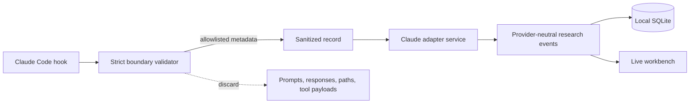

# Claude Code Adapter Plan

## Outcome

Claude Code users can point lifecycle hooks at the local Zmind+ runtime and see
sessions, subagents, tasks, tool activity, pauses, failures, and completion
without exporting conversation transcripts.

```text
Claude Code hook JSON (stdin)
        │
        ▼
local hook command
  validate → whitelist → hash identifiers → discard content and paths
        │
        ▼
sanitized lifecycle record
        │
        ▼
Zmind+ runtime adapter
  deduplicate → assign sequence → project graph events → persist → publish
        │
        ├────────► live workbench
        └────────► local SQLite history
```

The adapter is optional and provider-specific. The core event protocol, store,
runtime, and web application remain provider-neutral.

## Privacy boundary

The command accepts the current Claude Code hook envelope but only forwards a
small allowlist:

- hashed session, prompt, agent, task, and tool-use identifiers;
- hook event name and bounded agent/tool type labels;
- bounded duration and documented lifecycle reason enums;
- the local observation timestamp.

It never forwards or persists `cwd`, transcript paths, scratchpad paths,
prompts, task descriptions, tool inputs, tool outputs, assistant messages,
compact summaries, or arbitrary unknown fields. Task subjects are excluded in
the first release rather than hidden behind a surprising default.



## Event mapping

```text
Claude event       Graph/runtime result
─────────────────  ──────────────────────────────────────────────
SessionStart       create/resume a private run and root question
SubagentStart      create active branch + mark agent working
SubagentStop       complete branch + mark agent complete
TaskCreated        create an active task branch
TaskCompleted      mark the task branch complete
PostToolUse        update agent focus with tool name and duration
Stop               mark coordinator waiting
StopFailure        mark coordinator failed
SessionEnd         mark coordinator complete
```

The runtime bootstraps a run if hooks are enabled in the middle of an existing
Claude Code session. Stable delivery keys make retries idempotent. Sequence
numbers are assigned inside the single local runtime process so concurrent hook
commands cannot race each other.

## Installation contract

The built `zmind-claude-hook` executable reads exactly one JSON object from
stdin and sends only the sanitized record to the loopback runtime. A generated
settings fragment uses command hooks with `async: true`, so visualization can
never block the agent loop.

The initial fragment covers `SessionStart`, `SubagentStart`, `SubagentStop`,
`TaskCreated`, `TaskCompleted`, `PostToolUse`, `Stop`, `StopFailure`, and
`SessionEnd`. Users can place it in personal, shared-project, or project-local
Claude Code settings according to the scope they intend.

## Review gates

- Private strings placed in every excluded input field never appear in the
  sanitized request, persisted event JSON, API projection, or error output.
- Replaying an identical hook delivery creates no new events.
- A non-`SessionStart` first delivery creates a valid run before its activity.
- Subagent and task lifecycles update existing branches rather than duplicating
  them.
- Concurrent requests receive contiguous event sequences.
- The hook exits successfully when the visualization runtime is unavailable by
  default; strict failure is an explicit opt-in.
- Format, typecheck, unit/integration tests, build, audit, and public-boundary
  checks pass before release.
