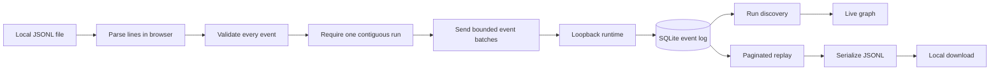

# Data Portability Plan

## Outcome

Make the local workbench useful without requiring a second terminal. A user can
bring a provider-neutral JSONL event log into Zmind+ and preserve the currently
selected run with one visible action each.

## Experience diagnosis

The runtime and CLI already support durable ingestion, but the browser exposes
no entry point. That makes the primary GUI feel like a viewer for engineers
rather than a local tool a researcher can operate.

```text
today
  file -> terminal -> CLI flags -> runtime -> refresh -> graph

target
  file -> Import -> validated locally -> graph appears
                                      -> helpful recovery if invalid

  current graph -> Export -> portable JSONL file
```

## Product decisions

| Decision           | Choice                                            | Reason                                                         |
| ------------------ | ------------------------------------------------- | -------------------------------------------------------------- |
| Import location    | Top-level workbench action                        | Discoverable from both demo and live modes                     |
| File format        | JSONL                                             | Stream-friendly and identical to the public SDK boundary       |
| Validation         | Validate the complete file before the first write | Prevent partial imports caused by malformed local files        |
| Write size         | Bounded batches                                   | Respect the runtime body limit and keep large imports reliable |
| Duplicate behavior | Idempotent success                                | Re-importing the same file should be safe                      |
| Export scope       | Currently selected run                            | One-click result with no configuration dialog                  |
| Privacy            | Browser-to-loopback only                          | The file never leaves the local deployment                     |
| Error copy         | Human-readable recovery                           | Never expose stack traces or schema internals by default       |

## Data flow



## Boundaries

- Import exactly one run per file in this first GUI flow. A mixed-run file is
  rejected with a specific message instead of silently splitting it.
- Require sequence zero and contiguous sequence numbers. The runtime remains
  the final authority for conflicts and idempotency.
- Limit files to 25 MiB in the browser and batches to a conservative serialized
  byte budget below the runtime's 1 MiB request ceiling.
- Keep the existing CLI for automation and very large archives.
- Do not add cloud storage, raw transcript capture, or provider-specific fields.

## Acceptance checks

1. A valid synthetic JSONL file imports from Demo mode and becomes selected.
2. Re-importing the same file succeeds without duplicating events.
3. Invalid JSON, invalid events, mixed run IDs, gaps, and oversized files are
   rejected before any request is sent.
4. A selected run exports every event across pagination in stable JSONL order.
5. Import/export controls are keyboard accessible and responsive.
6. Formatting, type-aware lint, strict TypeScript, unit tests, browser tests,
   production builds, security audit, and public-boundary scan all pass.

## Implementation review

Implemented on the local workbench boundary:

- The shared SDK now creates request batches constrained by both event count and
  serialized byte size, and owns lossless JSONL serialization.
- The workbench validates size, schema, one-run scope, start event, and sequence
  continuity before the first request.
- Successful imports refresh and open the new run immediately; repeat imports
  report an idempotent result.
- Export replays every page through the same contiguous-history guard used by
  live startup, then creates a filesystem-safe local download.
- User-facing progress, success, and recovery states are keyboard and
  screen-reader accessible without exposing raw file content.
