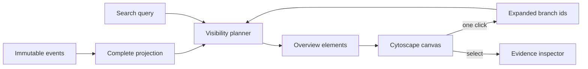

# Graph Scale and Progressive Disclosure Plan

## Outcome

Zmind+ must preserve a complete research record while keeping the canvas
legible and responsive. A run with thousands of observations should open as a
decision-oriented overview, not as a hairball.

```text
immutable events              complete projection
      │                              │
      └──────────────► projector ────┘
                                     │
                                     ▼
                           visibility budget
                           ┌─────────┼─────────┐
                           │         │         │
                        overview   expand    search
                        branches   one path   + context
                           │         │         │
                           └─────────┼─────────┘
                                     ▼
                              graph renderer
```

The visibility layer is a view over the projection. It never deletes or
rewrites events, and it must produce the same result for the same projection
and expansion state.

## Interaction contract

1. Small graphs open fully expanded.
2. Large graphs open with deep branches folded into summary nodes.
3. A folded node states how many descendants are hidden.
4. One click expands or folds a branch. Selecting a node still opens its
   inspector.
5. Search can reveal a matching node and its ancestry without permanently
   changing the user's expansion state.
6. Cross-links render only when both endpoints are visible. The source events
   remain available in the inspector and replay.



## Deterministic hierarchy

Research is a directed graph, not always a tree. Progressive disclosure needs
a stable display hierarchy without pretending that cross-links do not exist.

- Roots are nodes with no incoming edge. If a cyclic component has no root,
  its lexically first node becomes a display root.
- The first incoming structural edge in stable order is the display parent.
- `decomposes`, `proposes`, `challenges`, `tests`, and `produces` are
  structural edges.
- Challenge, support, refutation, contradiction, dependency, and supersession
  remain cross-links.
- Traversal is cycle-safe and ordered by node id as a final tie-breaker.

## Performance budgets

The initial benchmark covers projection and visibility planning independently
of browser rendering.

|       Corpus |  Events | Full projection target | Overview planning target | Initial visible nodes |
| -----------: | ------: | ---------------------: | -----------------------: | --------------------: |
|  1,000 nodes |  ~2,000 |               < 250 ms |                  < 25 ms |                <= 120 |
|  5,000 nodes | ~10,000 |                < 1.5 s |                  < 75 ms |                <= 160 |
| 20,000 nodes | ~40,000 |                  < 7 s |                 < 250 ms |                <= 220 |

These are development-machine guardrails, not universal promises. CI asserts
correctness and records timing; local benchmark output flags regressions
without introducing flaky wall-clock test failures.

## Delivery phases

### Phase A — model and benchmark

- Add a deterministic, provider-neutral corpus generator.
- Add visibility-planning pure functions and tests for DAGs and cycles.
- Record projection time, visibility time, visible count, and heap delta at
  1k, 5k, and 20k nodes.

### Phase B — canvas interaction

- Render folded counts directly on summary nodes.
- Make the fold affordance discoverable and keyboard accessible.
- Preserve selection, replay, and search semantics while the view changes.

### Phase C — browser acceptance

- Add a repeatable browser test that waits for the real canvas.
- Verify overview, expand, fold, search reveal, and inspector selection.
- Capture a synthetic public screenshot only after assertions pass.

## Review gates

- No research-specific names, transcripts, or workstation paths in committed
  artifacts.
- Event schemas remain backward compatible.
- The same inputs produce byte-equivalent ordered view descriptors.
- A cycle or malformed topology cannot hang the planner.
- Format, typecheck, tests, production build, and repository boundary scan all
  pass before each phase is pushed.
