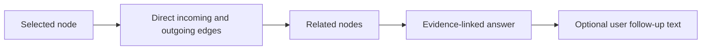

# Workbench Interaction Completion Plan

## Problem

The workbench presents four strong action affordances, but they must not be
decorative. A supervision tool loses trust the first time a prominent button
does nothing.

```text
human attention alert ──► select the exact decision node
graph node             ──► inspect its recorded context
"why current?"          ──► explain direct evidence relationships
close inspector        ──► return to the neutral selection state
```

`New inquiry` is removed until Zmind+ has a complete creation and agent-launch
protocol. A disabled or fake creation path would overstate the product.

## Evidence-linked questions

The first question experience is deliberately deterministic. It answers from
the recorded graph rather than inventing an LLM response.



- “Ask why this is current” opens a compact question field and immediately
  explains the direct relationships.
- The answer names the relationship, related node, and its current status.
- A follow-up question refreshes the same grounded answer with the user's
  wording visible, without implying that an external model ran.
- The panel states that the answer is derived locally from recorded graph
  relationships.

## Review gates

- Every visible workbench button has an observable result.
- The attention action reveals and selects the referenced node even inside a
  folded branch.
- Closing the inspector produces a clear neutral state.
- Keyboard and browser tests cover review, ask, and close.
- No question text is persisted or sent over the network.
