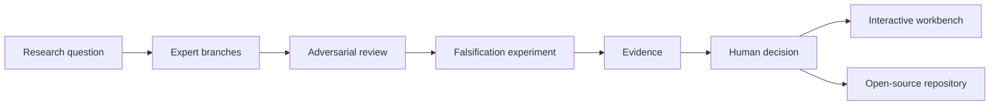

# Landing Page and Product Film Plan

## Narrative outcome

The public page must make one unfamiliar idea obvious in under twenty seconds:
Zmind+ turns a long-running, multi-agent research process into a map a human can
understand, challenge, and steer.

```text
visitor arrives
      │
      ▼
sees one research question split into expert workstreams
      │
      ▼
sees a reviewer challenge an assumption
      │
      ▼
sees an experiment replace confidence with evidence
      │
      ▼
understands the human decision point
      │
      ├────────► open the live workbench
      └────────► self-host from GitHub
```

The landing page is an editorial product story, not a literal mirror of every
current backend capability. All examples remain synthetic and provider-neutral.

## Information architecture

| Route        | Job                                      | Primary action            |
| ------------ | ---------------------------------------- | ------------------------- |
| `/`          | Explain and demonstrate the product      | Watch the research unfold |
| `/workbench` | Let people inspect the working prototype | Explore the live graph    |

The landing page uses one visual language: warm paper, near-black ink, electric
violet for active reasoning, mint for evidence, and coral for challenges. Large
editorial type establishes a distinct identity without relying on stock images
or decorative gradients.



## Page sequence

1. **Hero:** outcome-led statement and a living miniature research map.
2. **Research film:** a controlled five-act playback of delegation, challenge,
   experiment, evidence, and human judgment.
3. **Before / after:** chat transcript overload versus a navigable evidence map.
4. **Supervision primitives:** inspect, challenge, replay, and fold.
5. **Local-first architecture:** browser, local runtime, SQLite, adapters.
6. **Open-source close:** one command path to the workbench and GitHub.

## Motion contract

- Motion explains state change; it does not decorate static content.
- Playback can be paused and restarted with one click.
- The current act has a text equivalent and explicit progress state.
- `prefers-reduced-motion` disables automatic movement and shows the final state.
- The video capture uses the same DOM scene as the page, so the published film
  cannot drift away from the product story.

## Product film

The first film is a short, silent, captioned 16:9 sequence suitable for a README
preview and portfolio page.

```text
00–03s  One difficult research question
03–08s  Three experts receive independent workstreams
08–13s  Reviewer exposes a shared assumption
13–18s  Experiment returns contradictory evidence
18–23s  Graph updates; weak hypothesis is visibly refuted
23–28s  Human judgment request appears
28–32s  Zmind+ end card + local-first / open-source promise
```

Deliverables:

- deterministic landing animation;
- browser test for narrative controls and reduced-motion fallback;
- poster image captured after assertions;
- WebM master and MP4 derivative generated from the tested scene;
- no autoplay audio and no external tracking.

## Review gates

- At 1440 px, the hero communicates the product before the first scroll.
- At 390 px, copy, controls, and the animated scene remain usable.
- The public route contains no implementation jargon in primary copy.
- Every CTA has a real destination; no dead buttons.
- Lighthouse-oriented basics: semantic sections, one `h1`, focus visibility,
  descriptive labels, and reduced-motion support.
- Format, typecheck, unit tests, browser tests, build, audit, and boundary scan
  pass before publishing.
