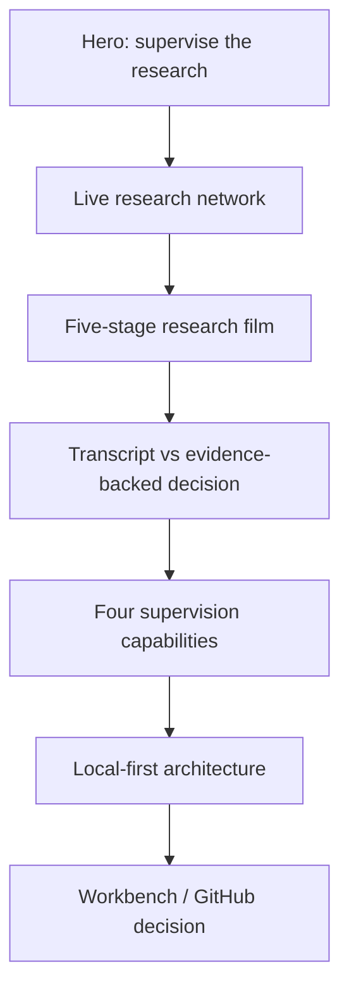

# Landing Visual Overhaul Plan

Status: In progress on `codex/landing-visual-overhaul`.

## Outcome

Turn the landing page from a sparse product brochure into a legible, cinematic
demonstration of agent-research supervision. Preserve the existing product
claims and routes; change presentation, hierarchy, motion, and responsive
composition only.

```text
CURRENT                                      TARGET

tiny diagram + large empty areas             live command surface
             |                                         |
             v                                         v
generic stacked sections                    one continuous research story
             |                                         |
             v                                         v
long, repetitive mobile page                compact, readable mobile chapters
```

## Experience architecture



## Design decisions

| Area | Decision | Why |
| --- | --- | --- |
| Visual direction | Dark research command center with warm editorial surfaces | Makes the graph feel like the product rather than an illustration |
| Hero | Full-viewport composition with a large readable graph and live activity rail | Demonstrates the core idea before asking the visitor to scroll |
| Motion | Purposeful node, edge, status, and chapter transitions | Shows changing research state without decorative noise |
| Narrative | Keep five stages, but make the active stage visually dominant | Visitors can understand the product in one pass |
| Proof | Replace generic whitespace with evidence, reversal, and human-decision moments | Product value becomes concrete |
| Mobile | Collapse secondary chrome, use horizontal chapter controls, reduce section heights | Avoid the current excessively long and miniature layout |
| Accessibility | Visible focus, semantic controls, reduced-motion final state, readable contrast | The cinematic direction remains usable |

## Delivery phases

1. Recompose the hero and global visual system.
2. Rebuild the research-film stage and supporting sections.
3. Tune tablet/mobile layouts and reduced motion.
4. Run unit, type, lint, build, public-boundary, and browser checks.
5. Capture desktop/mobile screenshots, review them, and revise before merge.

## Acceptance checks

- The first viewport explains question → agents → critique → decision without
  requiring tiny text.
- The primary workbench action is visible immediately on desktop and mobile.
- The research film remains controllable and reaches a stable final state when
  reduced motion is enabled.
- No horizontal overflow at 390 px, 768 px, or 1440 px.
- Public-demo mode still makes no runtime API requests.
- `/workbench` behavior is unchanged.
