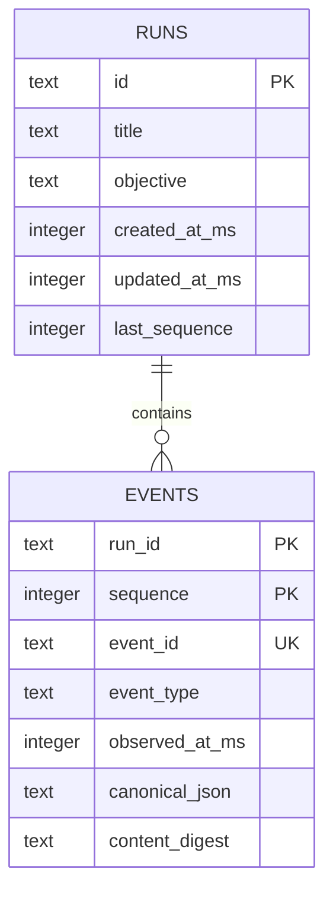
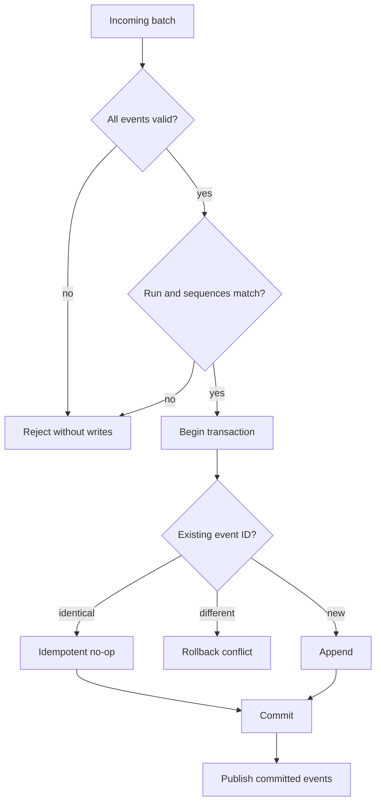

# Local Runtime Implementation Plan

Date: 2026-10-26

Status: In progress on `codex/foundation`.

## Outcome

Turn the static workbench into a real local application that can ingest agent
events, persist them, rebuild a research projection, and resume a live browser
stream after a disconnect.

```text
agent hook / adapter
        |
        | POST validated event batch
        v
┌─────────────────────────────────────┐
│ local runtime                       │
│                                     │
│ validate -> append transaction      │
│                  |                  │
│                  +-> SQLite         │
│                  +-> live event bus │
└──────────────────┬──────────────────┘
                   |
                   | snapshot + SSE
                   v
             browser workbench
```

## Runtime contract

### Write path

`POST /api/runs/:runId/events`

- Accepts one event or a bounded array.
- Validates the complete request before opening a transaction.
- Requires URL run ID to match every event body.
- Treats an existing identical event as an idempotent retry.
- Rejects an existing event ID with different content.
- Rejects gaps and non-monotonic run sequences.
- Commits the full batch or none of it.
- Publishes only after commit.

### Read path

```text
GET /api/runs/:runId/events?after=<sequence>&limit=<n>
GET /api/runs/:runId/projection
GET /api/runs/:runId/stream?after=<sequence>
GET /api/runs
GET /health
```

The SSE stream first replays committed events after the supplied sequence, then
switches to live delivery. Event IDs use the run sequence so the browser can
reconnect with `Last-Event-ID` without inventing a second cursor system.

## Persistence model



SQLite settings:

- WAL journal mode for readers during ingestion.
- Foreign keys enabled.
- Busy timeout for short concurrent bursts.
- Explicit transactions for every batch.
- Canonical JSON digest used to distinguish retries from conflicts.

## Failure behavior



## Security and privacy

- Bind to `127.0.0.1` by default.
- Do not enable CORS globally; allow only the configured local UI origin.
- Cap request bytes, batch size, replay limits, and SSE clients.
- Do not log event payloads.
- Return human-readable errors without absolute paths or database internals.
- Database path is configurable and excluded from version control.

## Phase review checklist

- Store tests cover append, replay, idempotency, conflict, gaps, and rollback.
- API tests cover validation, projection, and reconnect replay.
- Browser can fall back to the synthetic in-memory scenario when the runtime is
  unavailable, with a clear status indicator.
- Fresh install requires only Node.js and `npm install`.
- Production build and the public-boundary scan remain clean.
