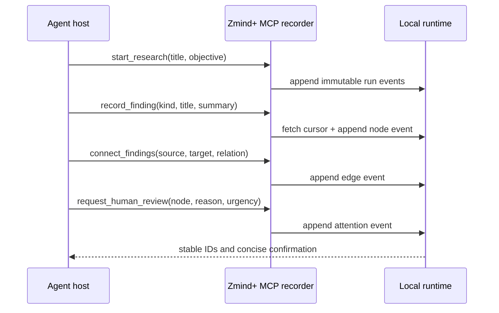

# MCP Research Recorder Plan

## Outcome

Any MCP-capable agent host can explicitly record the semantic shape of its
research in Zmind+ while the lifecycle adapter continues to record automatic
activity metadata.

```text
automatic hooks                     explicit MCP tools
session / agent / task / tool       question / claim / critique / evidence
              │                                  │
              └──────────────┬───────────────────┘
                             ▼
                 provider-neutral event log
                             ▼
                  live, inspectable workbench
```

The MCP server uses the official TypeScript SDK v2 over stdio. It never reads a
transcript. Research text reaches Zmind+ only when an agent intentionally calls
a recorder tool with that text.



## Tool contract

- `start_research`: begins a named run and creates its root question.
- `record_finding`: creates or updates one typed node and returns its stable ID.
- `connect_findings`: records an evidence, challenge, test, dependency, or
  decomposition relationship between existing nodes.
- `request_human_review`: raises a visible decision request on a node.
- `get_research_state`: returns a compact node/edge/status summary, not raw
  event JSON.

IDs may be supplied for deterministic updates or generated locally. Every
write validates against the same core schemas as JSONL and Hook ingestion.
Conflicts refresh the run cursor and retry a bounded number of times so Hook
events and MCP writes can safely interleave.

## Safety and UX

- stdio stdout is reserved exclusively for MCP protocol messages;
- the runtime defaults to loopback and errors never echo submitted content;
- descriptions tell the model to record conclusions and evidence, not hidden
  reasoning or full transcripts;
- no tool deletes history;
- starting a new run is explicit, while subsequent tools reuse that run in the
  same MCP process.

## Review gates

- Official SDK client can initialize, list all tools, and execute a complete
  research path against a real temporary runtime.
- Concurrent Hook and MCP writes produce one contiguous event sequence.
- Invalid node kinds, relations, references, and oversized text fail before a
  write.
- stdout remains valid MCP traffic and diagnostics use stderr only.
- Format, typecheck, tests, build, audit, and public-boundary checks pass.
