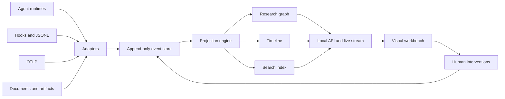
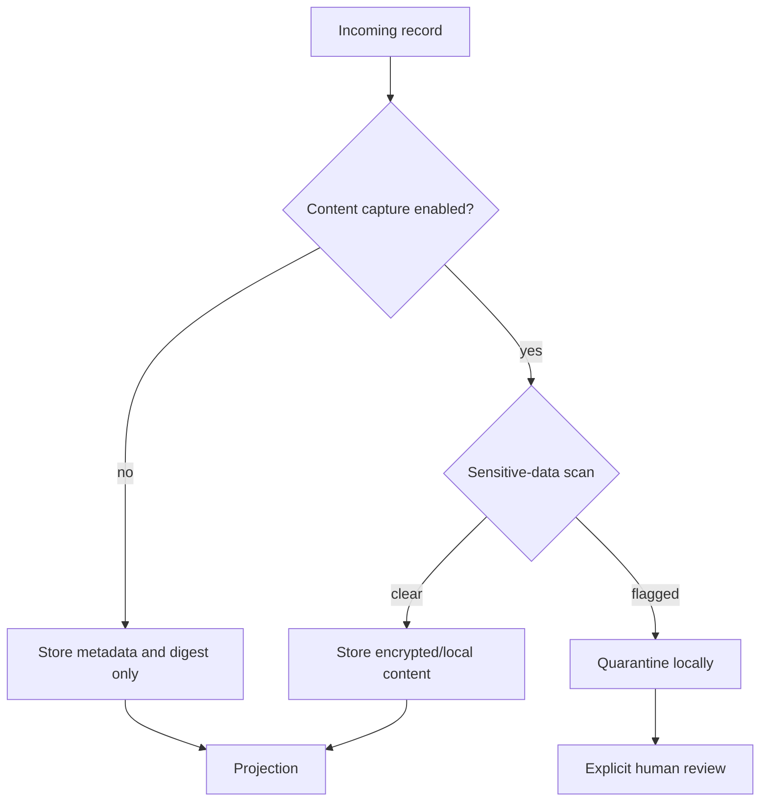

# Zmind+ Product and Architecture Plan

Date: 2026-10-26

Status: Foundation approved; implementation begins with a synthetic live run.

## 1. Product definition

Zmind+ is a local-first research supervision workbench. It observes multiple
agents, reconstructs the meaning of their work, and gives the human one place
to inspect evidence, challenge a node, redirect work, and understand how a
conclusion changed.

It is not another generic LLM trace table.

```text
Traditional observability             Zmind+
──────────────────────────────         ──────────────────────────────
request → spans → latency              question → hypotheses
tool calls → status                    critiques → experiments
tokens → cost                          evidence → decisions
single-run debugging                   cross-session conclusion history
operator reads implementation          human sees research meaning
```

## 2. Primary experience

```text
┌─────────────────────────────────────────────────────────────────────┐
│ Research objective                         7 active · 2 need review │
├────────────────────┬──────────────────────────────┬─────────────────┤
│ Workstreams        │ Living research graph        │ Inspector       │
│                    │                               │                 │
│ Architecture  ●    │ question                     │ Why this node?  │
│ Security      ●    │  ├─ hypothesis               │ Evidence        │
│ Performance   ◐    │  │   ├─ critique             │ Contradictions  │
│ Failure cases ✓    │  │   └─ experiment           │ Source context  │
│                    │  └─ alternative               │ Ask / redirect  │
├────────────────────┴──────────────────────────────┴─────────────────┤
│ Live activity · reviewer challenged the performance assumption     │
└─────────────────────────────────────────────────────────────────────┘
```

Progressive disclosure keeps large histories usable:

1. Overview shows workstreams, state, conflict, and human attention requests.
2. Semantic zoom reveals claims, agents, and experiments.
3. Selecting a node opens evidence, provenance, and conclusion history.
4. Raw events remain available for debugging but never dominate the interface.

## 3. Core domain

### Immutable event layer

Events record what happened. They are append-only and source-addressable.

```text
Event
├── identity: id, run, parent, sequence
├── time: observed_at, effective_at
├── actor: human | agent | tool | system
├── kind: lifecycle | research | artifact | intervention
├── payload: versioned, validated body
├── provenance: adapter, source locator, content digest
└── privacy: content policy, redaction state
```

### Research graph projection

Nodes explain what the work means:

- `question`
- `hypothesis`
- `proposal`
- `critique`
- `experiment`
- `evidence`
- `decision`
- `claim`
- `lesson`
- `artifact`

Edges explain why nodes relate:

- `decomposes`
- `proposes`
- `challenges`
- `tests`
- `supports`
- `refutes`
- `contradicts`
- `depends_on`
- `supersedes`
- `produces`

The graph is a projection, not storage authority. A new parser or corrected
linker can rebuild it without rewriting history.

## 4. System architecture



### Deployment profile

```text
Default: one local process + SQLite + browser UI
Team:    container + PostgreSQL + authenticated browser UI
Input:   files, stdin, local hooks, OTLP/HTTP
Output:  local WebSocket/SSE, JSON export, static replay bundle
```

SQLite is the default because the first user is a single local operator. The
storage interface must permit PostgreSQL later without changing event semantics.

## 5. Technology decisions

| Concern | Decision | Reason |
|---|---|---|
| Language | TypeScript, strict | One schema across adapters, server, and UI |
| Runtime | Active Node.js LTS/current | Portable local daemon and broad ecosystem |
| UI | React + Vite | Fast local startup without framework server coupling |
| Styling | Tailwind CSS + CSS variables | Rapid iteration with explicit visual tokens |
| Validation | Zod | Runtime validation at every trust boundary |
| Storage | SQLite first | Zero-configuration, durable local deployment |
| Live updates | SSE initially | Reconnectable one-way event stream; commands remain HTTP |
| Graph | Cytoscape.js pilot | Mature interactions and compound graph support |
| Large graph fallback | Sigma.js adapter | WebGL path if scale tests exceed canvas budget |
| Interop | OpenTelemetry-compatible adapter | Accept existing instrumentation without adopting spans as the domain model |
| Tests | Vitest + Playwright | Fast domain tests and real interaction coverage |

The renderer decision is evidence-gated. Cytoscape.js supports compound graphs
needed for collapsible workstreams, but compound nodes carry a performance cost.
The pilot must benchmark 1k, 5k, and 20k-node scenarios before the interface is
coupled to it.

## 6. Privacy and repository boundary



- Prompt, response, file, and tool-result content is opt-in.
- Source locators are normalized and workstation paths are not exported.
- Public fixtures are authored synthetic scenarios, never transformed private
  sessions.
- CI scans tracked files for secrets and unexpected binary artifacts.
- Static replay export has its own explicit redaction pass.

## 7. Delivery phases

### Phase 0 — Foundation

- Product and architecture decision record.
- Public data boundary and contribution rules.
- Typed event and graph contracts.

### Phase 1 — Executable vertical slice

- Synthetic multi-agent research run.
- Append-only in-memory store and deterministic projector.
- Three-pane workbench with graph, live activity, and inspector.
- Expand/collapse, filtering, search, and reduced-motion behavior.

### Phase 2 — Local runtime

- SQLite event store.
- File/JSONL adapter SDK.
- Live ingestion endpoint and reconnectable event stream.
- One-command local startup and Docker image.

### Phase 3 — Agent integrations

- Hook adapter for a coding-agent runtime.
- OTLP ingest adapter.
- Document/artifact indexing.
- Intervention command boundary with explicit confirmation.

### Phase 4 — Scale and portfolio release

- 20k-node render benchmark and renderer decision.
- Deterministic replay mode for product video.
- Accessibility and keyboard-navigation audit.
- Threat model, release signing, and reproducible builds.

## 8. Acceptance criteria for the first public milestone

- A new user reaches the live workbench with one documented command.
- The synthetic run visibly delegates experts, triggers a critique, launches an
  experiment, and reverses a conclusion.
- A user can answer “why is this conclusion current?” in two interactions.
- Collapsed overview remains legible with at least 1,000 projected nodes.
- Raw content capture is off by default.
- The application works without an account, API key, or cloud service.
- No private or project-specific data exists anywhere in repository history.

