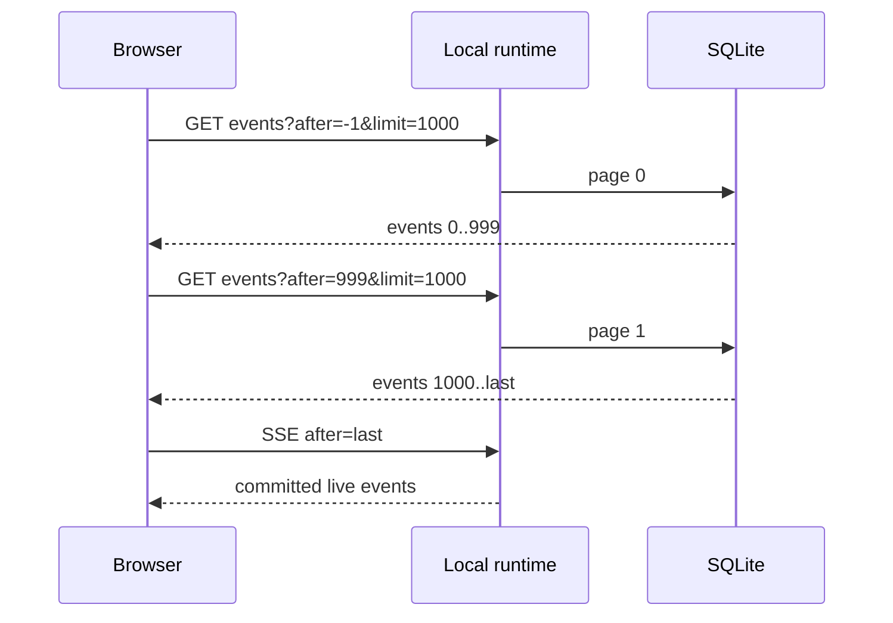
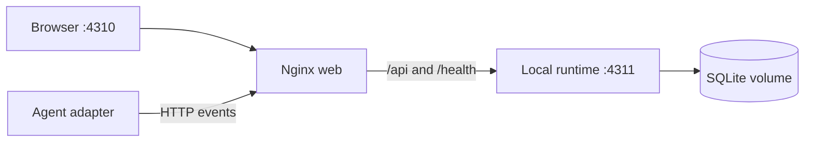

# Reliability, Privacy, and Self-hosting Plan

## Completion gaps

The interactive prototype already demonstrates the product, but three release
boundaries must be closed before a large local run is trustworthy.

```text
large event history
      │
      ├──► paginated HTTP bootstrap ──► browser projection
      ├──► complete SQLite replay ────► server projection
      └──► complete SSE catch-up ─────► live continuation

external event
      │
      └──► runtime validation ──► privacy-safe locator ──► append-only store

source tree
      │
      └──► CI gates ──► tested containers ──► local self-host
```

## Phase A — complete replay

- Add a store iterator that reads every page after a cursor.
- Use it for server projections and SSE catch-up.
- Bootstrap the browser through bounded HTTP pages until the run cursor is
  complete, then open the live stream from the exact final sequence.
- Verify histories larger than each individual page limit.



## Phase B — enforce the privacy boundary

- Raw content remains absent from the public event schema.
- `contentCaptured` defaults to `false` when omitted.
- Source locators reject absolute Unix paths, Windows drive paths, home-relative
  paths, and `file:` URLs at the validation boundary.
- HTTPS URLs, logical adapter locators, and repository-relative paths remain
  valid.
- CI scans tracked text for credential-shaped values and accidental absolute
  workstation paths.

## Phase C — reproducible self-hosting

- One multi-stage Dockerfile builds the runtime and static web image.
- Compose starts the API and web proxy with a persistent SQLite volume.
- The runtime binds to the container interface only inside the private Compose
  network; the public port belongs to the web reverse proxy.
- Nginx proxies HTTP ingestion and SSE without buffering.
- Health checks prove both services are usable before handoff.



## Phase D — continuous verification

Pull requests and branch pushes run:

1. immutable install;
2. formatting and strict type checks;
3. unit and integration tests;
4. browser acceptance tests;
5. production build and dependency audit;
6. repository privacy scan;
7. Docker image build.

The generated product film is reproducible but is not regenerated in normal CI,
because it is a reviewed release artifact rather than a correctness gate.

## Release gates

- A run beyond 10,000 events produces the same node count in store, API, and UI
  bootstrap projections.
- Reconnect never silently skips an event because of an internal page cap.
- Unsafe source locators fail before storage.
- `docker compose up --build` reaches healthy status from a clean checkout.
- CI contains no repository-specific research data or secrets.
