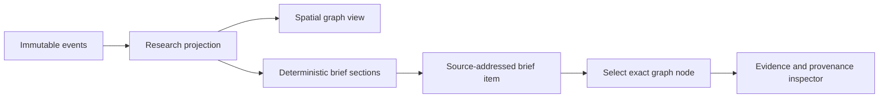

# Structured Research Brief Plan

## Outcome

Let a human move between a spatial map and a readable research document without
losing provenance. The brief is a deterministic view of the same local event
projection, not a generated narrative or a second source of truth.

## Experience diagnosis

A graph answers “where did the work branch?” but makes linear review expensive.
The current inspector explains one node at a time; it does not provide a fast
way to scan the current decision, strongest evidence, reversals, experiments,
and unresolved challenges.

```text
overview task                     best surface
──────────────────────────────    ─────────────────────
see delegation and branching      Graph
inspect one claim's lineage        Inspector
read the current research state    Brief
return to exact supporting node    Brief item -> Graph
```

## Interaction model

```text
Living research                    Structured brief
┌──────────────────────────┐       ┌──────────────────────────┐
│ Graph  [Brief]           │       │ [Graph]  Brief           │
│                          │       │ Current decision         │
│   question               │  <->  │ Evidence                │
│    ├─ critique           │       │ Reversals               │
│    └─ experiment         │       │ Open challenges         │
│                          │       │ Experiments              │
└──────────────────────────┘       └──────────────────────────┘
                                              │
                                  click item ─┴─> graph + inspector
```

## Projection flow



## Deterministic section rules

| Section          | Included nodes                                    | Ordering                                   |
| ---------------- | ------------------------------------------------- | ------------------------------------------ |
| Current decision | decision, supported/current claims                | decisions first, then confidence and title |
| Evidence         | evidence with supported or complete status        | confidence, then title                     |
| Reversals        | refuted or superseded nodes                       | kind, then title                           |
| Open challenges  | active, blocked, or contested critiques/questions | status, then title                         |
| Experiments      | experiment nodes                                  | active before complete, then title         |

- Every row carries its node ID and opens the existing inspector.
- Empty sections say what is missing instead of disappearing.
- Large sections show a bounded initial set and expand in one click.
- The brief never infers facts that are absent from recorded nodes.
- Search filters both graph nodes and brief rows using the existing query.

## Acceptance checks

1. Graph and Brief switch in one click and preserve the selected run.
2. The brief exposes current decisions, evidence, reversals, open challenges,
   and experiments using only projected local nodes.
3. Clicking a brief item switches to the graph and opens the exact node.
4. Search produces the same semantic matches in both views.
5. Empty and large runs remain understandable and keyboard accessible.
6. Unit, browser, formatting, lint, type, build, privacy, and scale checks pass.

## Implementation review

- Graph and Brief are peer views selected by one compact control.
- Five deterministic sections are projected from the current local graph; no
  new persistence layer or model-generated prose was introduced.
- Confidence, status, kind, summary, and source node identity remain visible.
- Clicking any brief row returns to the graph and opens the existing provenance
  inspector on that exact node.
- Search shares one matcher across graph disclosure and brief filtering,
  including title, summary, kind, status, and tags.
- Desktop and mobile renders were visually reviewed; mobile rows wrap full
  conclusions instead of truncating the document's primary content.
