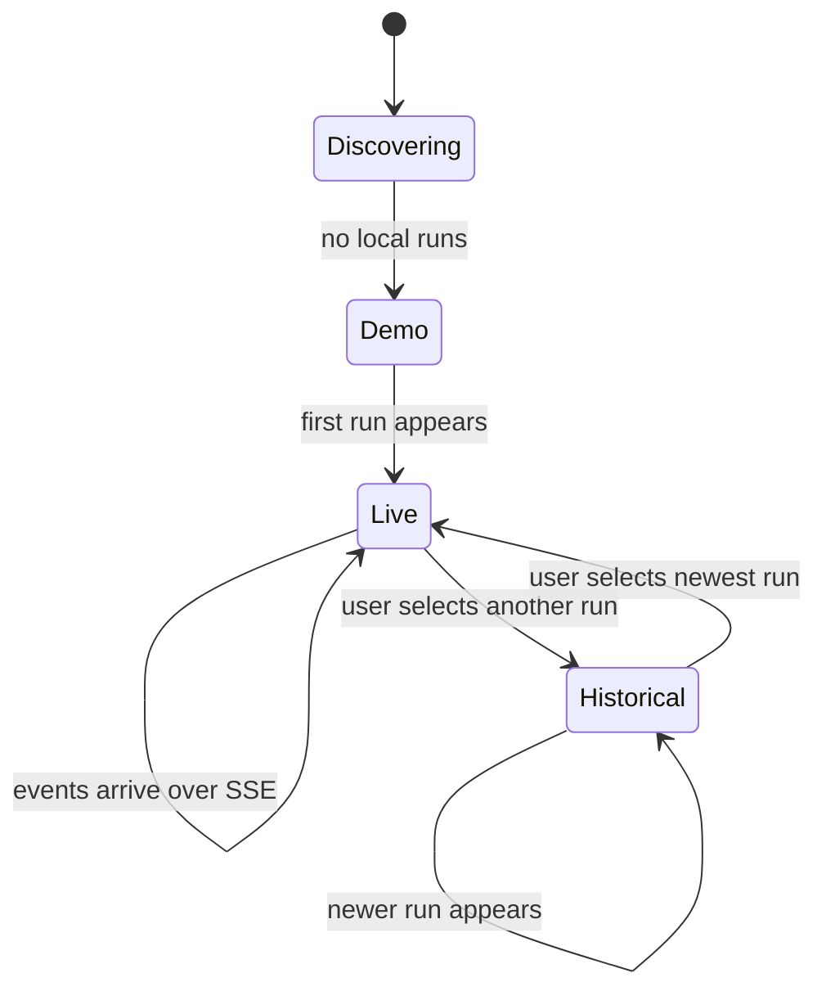

# Live Run Discovery Plan

## Outcome

The workbench discovers a research run that starts after the page is already
open and lets the user switch between local runs without reloading.

```text
runtime run index ──poll──► local run list
                               │
             no choice yet ────┤ auto-follow newest
                               │
             user choice ──────┤ keep selected history
                               ▼
                    replay + live SSE stream
```

The newest run is selected automatically until the user explicitly chooses a
run. A manual choice remains stable when another run appears, preventing the
interface from unexpectedly replacing evidence under review.



## Interaction contract

- Run discovery polls a lightweight local index; event data still travels by
  one replay followed by SSE.
- The top bar shows the current run title as a native one-click selector only
  when multiple runs exist.
- Switching runs closes the previous stream, resets replay state, and connects
  to the selected run.
- A run that appears while the page is in Demo mode becomes live automatically.
- Network failure preserves the last committed view and reports reconnecting;
  it does not silently replace a real run with synthetic data.

## Review gates

- Initial empty index followed by a new run transitions Demo to Live.
- A manual historical selection survives subsequent polling.
- Stream cleanup prevents events from the previous run entering the new one.
- Desktop and mobile controls remain keyboard-accessible.
- Unit tests, browser tests, typecheck, build, and public-boundary checks pass.
