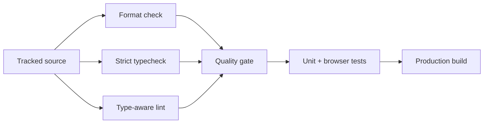

# Static Analysis Gate Plan

## Outcome

Every TypeScript workspace is checked by one root ESLint gate in addition to
formatting, strict compilation, tests, and production builds.

```text
source files
   ├── Prettier       formatting consistency
   ├── TypeScript     type and module correctness
   ├── ESLint         unsafe patterns + framework invariants
   └── tests/build    behavior + packaging
```

The configuration uses ESLint flat config, type-aware `typescript-eslint`
rules, and React Hooks rules for the web workspace. Generated bundles, browser
artifacts, dependencies, and public media are excluded.



## Review gates

- `npm run lint` checks every app, package, script, and configuration file.
- React effects and hooks obey dependency and lifecycle rules.
- Async calls are either awaited, returned, or explicitly detached.
- Tests may use intentionally broad fixtures only through narrow overrides.
- The existing full suite and production build remain green after fixes.
